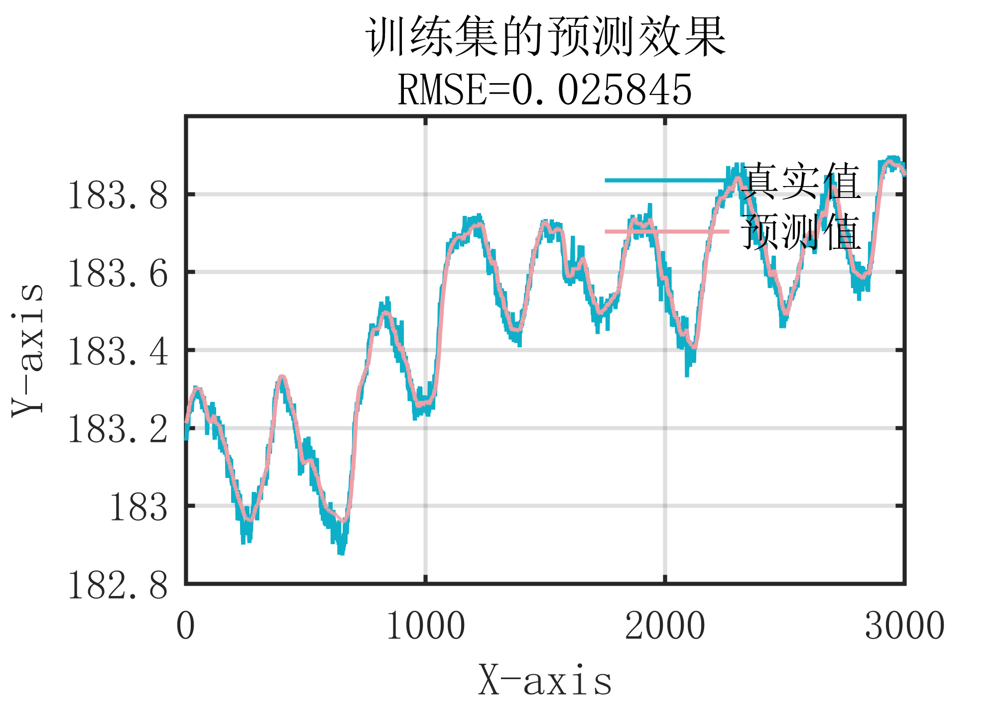
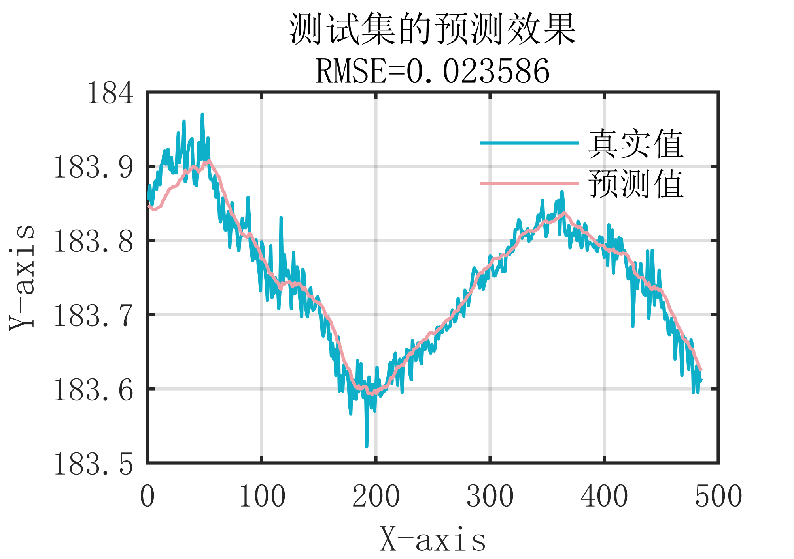

# MATLAB | Time Series Forecasting | BiLSTM Bidirectional Long Short-Term Memory Neural Network | Includes Data and Output Code | Directly Useable

1. Basic definition
BiLSTM (Bidirectional Long Short-Term Memory Networks) is a widely used deep learning model in fields such as natural language processing and time series analysis. It is a variant of the LSTM (Long Short-Term Memory) network, which enhances the model's ability to perceive contextual information through its bidirectional structure. The BiLSTM model consists of two LSTM layers: one reads from the input sequence forward, and the other reads from it backward. The outputs of these two LSTM layers are then concatenated and fed into subsequent fully connected layers for classification or prediction.
2. Drawing effect
The attached images show the following effects:
\n        \n      \n        \n      Attached is a video tutorial for operation:
\n        \n          \n          \n          \n          \n          \n            To view this video, please enable JavaScript, and consider upgrading to a\n            web browser that\n            supports HTML5 video.

## Images

<!-- PAYMENT_BLOCK -->

## Get this dataset

- Payment link (Stripe): [Buy now](https://buy.stripe.com/3cs8yP7sY87d0vu9AB)
- Payment QR code: 

<!-- /PAYMENT_BLOCK -->
